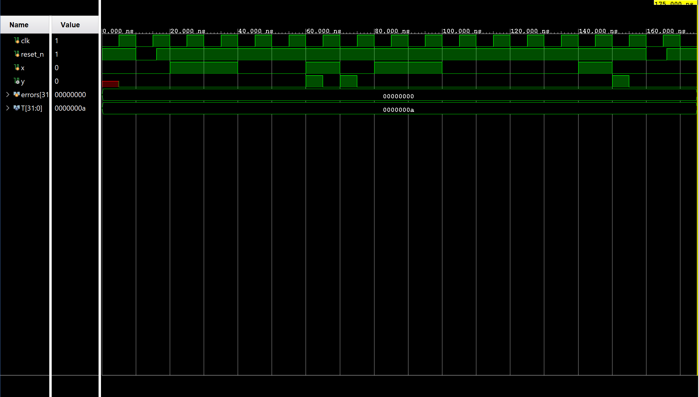
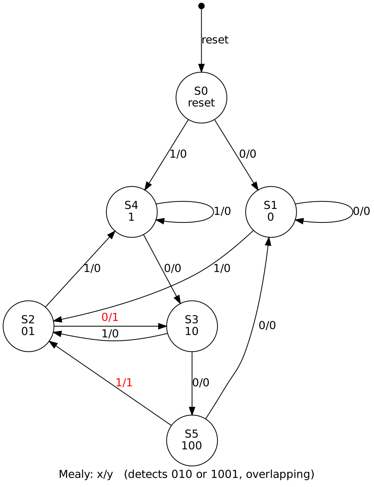
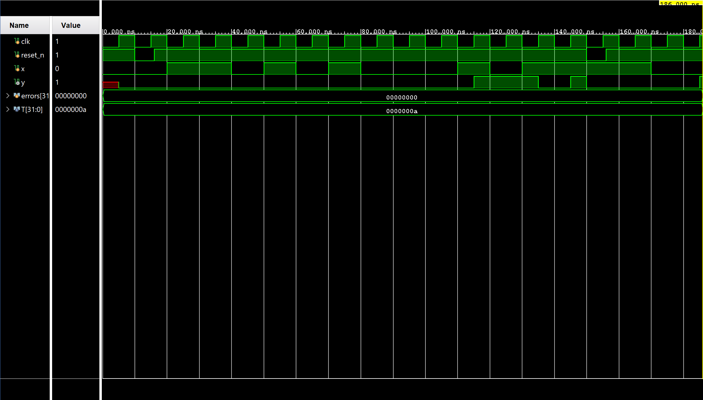
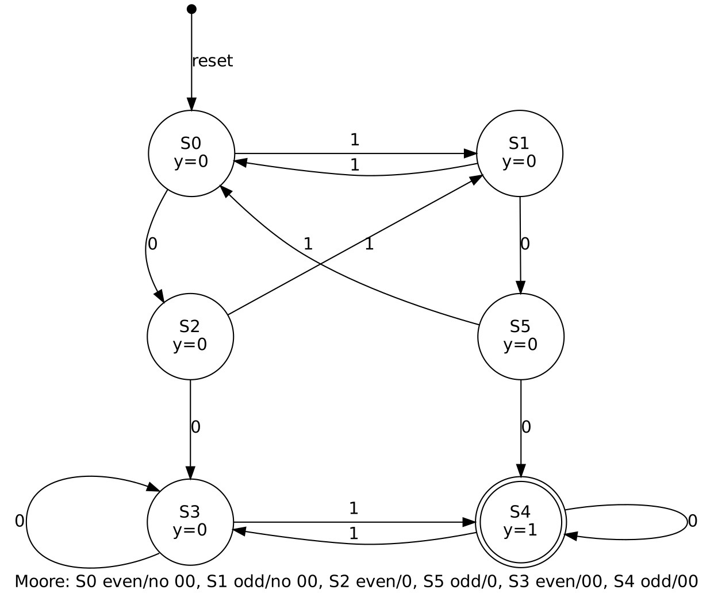
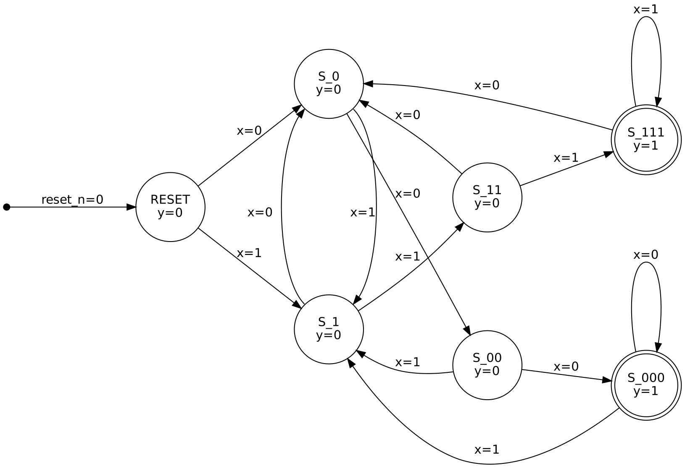

# ece3300L-lab7 : Finite State Machines (FSMs)
## Files
### Design
- [`src/dual_sequence_detector.v`](verilog/design/dual_sequence_detector.v) – Part 1: Mealy FSM, detects 010 or 1001
- [`src/even_odd_conseq00.v`](verilog/design/even_odd_conseq00.v) – Part 1: Moore FSM, odd number of 1s and 00
- [`src/conseq_sequence.v`](verilog/design/conseq_sequence.v) – Part 2: Moore FSM, detects 111 or 000
### Sim
- [`tb/dual_sequence_detector_tb.v`](verilog/sim/dual_sequence_detector_tb.v) – Part 1 dual sequence detector testbench
- [`tb/even_odd_conseq00_tb.v`](verilog/sim/even_odd_conseq00_tb.v) – Part 1 even/odd consecutive 00 testbench
- [`tb/conseq_sequence_tb.v`](verilog/sim/conseq_sequence_tb.v) – Part 2 testbench
## Part 1: FSMs from Videos
### Dual Sequence Detector
Simulation waveform:

State diagram:

### Even/Odd Consecutive 00
Simulation waveform:

State diagram:

## Part 2: Three Consecutive 1s or 0s Detector
Simulation waveform:

State diagram:

